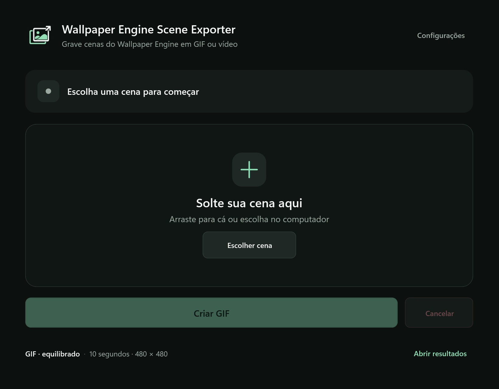

# Wallpaper Engine Scene Exporter

**Grave cenas do Wallpaper Engine e exporte a animação como GIF ou vídeo MP4.**

[](https://github.com/JoaoVittorIshida/wallpaper-engine-scene-exporter/actions/workflows/ci.yml)
[](LICENSE)

Um aplicativo Windows para transformar um arquivo `scene.pkg` em uma animação que você pode compartilhar ou usar em uma tela auxiliar. Escolha a cena, defina o tamanho e a duração e acompanhe a gravação.

O aplicativo usa o **próprio Wallpaper Engine para renderizar a cena** em uma janela dedicada. Windows Graphics Capture grava essa janela e FFmpeg gera o resultado. O Wallpaper Engine instalado e licenciado é um requisito.



[Baixar a versão mais recente](https://github.com/JoaoVittorIshida/wallpaper-engine-scene-exporter/releases/latest) · [Histórico de alterações](CHANGELOG.md) · [Reportar um problema](https://github.com/JoaoVittorIshida/wallpaper-engine-scene-exporter/issues)

## O que ele faz

- Recebe uma Scene `.pkg` por arrastar e soltar ou pelo seletor de arquivos.
- Exporta GIF animado em loop ou MP4 com H.264, sem áudio.
- Permite escolher resolução, duração e FPS de captura.
- Oferece presets de GIF e ajustes de cores, dithering e FPS.
- Captura somente a janela de renderização, sem trocar o wallpaper do desktop.
- Mostra progresso, permite cancelar e recupera entradas após interrupções.
- Pode iniciar automaticamente quando uma Scene chega à pasta `input`.

## Instalação e primeiro uso

**Requisitos:** Windows 10 versão 2004 ou posterior / Windows 11, x64, e Wallpaper Engine instalado pela Steam.

1. Baixe `WallpaperEngineSceneExporter-1.2.1-win-x64.zip` na página de [Releases](https://github.com/JoaoVittorIshida/wallpaper-engine-scene-exporter/releases/latest).
2. Extraia o ZIP inteiro para uma pasta onde você tenha permissão de gravação.
3. Abra **WallpaperSceneExporter.exe**.

O pacote inclui **.NET 10, FFmpeg e ffprobe**. Não precisa instalar dependências nem baixar ferramentas na primeira abertura. Mantenha a subpasta `ffmpeg` junto do executável. Se você já possui FFmpeg e ffprobe compatíveis, pode informar outro caminho em **Configurações**; os dois executáveis precisam estar na mesma pasta.

O arquivo `SHA256SUMS.txt` da release permite conferir a integridade do ZIP:

```powershell
Get-FileHash .\WallpaperEngineSceneExporter-1.2.1-win-x64.zip -Algorithm SHA256
```

## Grave sua primeira cena

1. Arraste um arquivo `.pkg` para a janela ou clique em **Escolher cena**.
2. Abra **Configurações** e selecione GIF ou vídeo, duração e tamanho.
3. Clique em **Criar GIF** ou **Criar vídeo**.
4. Use **Abrir resultados** para acessar a pasta `output`.

A configuração inicial usa **480 × 480 pixels**, **10 segundos** e captura a **60 FPS**. O preset equilibrado de GIF gera 30 FPS e até 256 cores.

| Saída | Como escolher |
| --- | --- |
| **GIF** | Animação em loop. O tamanho depende bastante do movimento, da resolução e dos FPS. |
| **MP4** | Vídeo H.264, indicado para manter mais detalhes e para publicar demonstrações em vídeo. |

Os presets de qualidade se aplicam ao GIF. MP4 usa H.264 em alta qualidade, na resolução e no FPS de captura configurados.

## Seus arquivos

O seletor e o arrastar e soltar **copiam** a Scene para a entrada do aplicativo, mantendo o arquivo original escolhido. Após a exportação validada, a cópia processada é removida.

Se você colocar o arquivo manualmente em `input/scene.pkg`, esse próprio arquivo será consumido após o sucesso; mantenha um backup se quiser conservá-lo.

- Erro ou cancelamento: a entrada processada é restaurada.
- Outra Scene já está aguardando: a anterior é preservada em `input/failed`.
- Interrupção inesperada: trabalhos remanescentes são recuperados na próxima abertura.
- Falha na restauração: o pacote permanece na área temporária para recuperação posterior.

Arquivos incompletos ficam na área temporária, em vez de aparecerem como resultados prontos. Uma mudança de tamanho da janela durante a captura interrompe a exportação para evitar um vídeo congelado.

## Configuração

Ajuste as opções pela janela **Configurações** ou em `config.json`, ao lado do executável:

```json
{
  "outputFormat": "gif",
  "qualityPreset": "high",
  "durationSeconds": 10,
  "warmupSeconds": 2,
  "captureFps": 60,
  "width": 480,
  "height": 480,
  "gifFps": null,
  "gifColors": null,
  "gifDithering": null,
  "keepFailedArtifacts": false,
  "autoProcess": false,
  "wallpaperEnginePath": "",
  "ffmpegPath": ""
}
```

| Preset de GIF | FPS | Cores |
| --- | ---: | ---: |
| `compact` | 20 | 256 |
| `high` | 30 | 256 |
| `maximum` | 50 | 256 |

`null` nos ajustes de GIF usa o preset. Largura e altura precisam ser pares para H.264. `autoProcess` inicia a conversão ao receber uma entrada; cancelar não repete automaticamente o mesmo trabalho.

O Wallpaper Engine é procurado na instalação padrão da Steam e nas bibliotecas registradas em `libraryfolders.vdf`, respeitando a versão de 32 ou 64 bits já em execução. FFmpeg é procurado no caminho configurado, na subpasta `ffmpeg` e no `PATH`.

## Desenvolvimento

**Stack:** C# 13, WPF, .NET 10 LTS, CommunityToolkit.Mvvm, Direct3D 11, Windows Graphics Capture e FFmpeg.

Instale o [SDK .NET 10](https://dotnet.microsoft.com/download/dotnet/10.0) compatível com `global.json`. Em um terminal PowerShell no Windows:

```powershell
git clone https://github.com/JoaoVittorIshida/wallpaper-engine-scene-exporter.git
cd wallpaper-engine-scene-exporter
.\scripts\Install-Ffmpeg.ps1
dotnet restore WallpaperSceneExporter.sln --locked-mode -p:Platform=x64
dotnet build WallpaperSceneExporter.sln -c Release -p:Platform=x64 --no-restore -warnaserror
dotnet test WallpaperSceneExporter.sln -c Release -p:Platform=x64 --no-build --no-restore
```

FFmpeg e ffprobe são necessários para os testes de integração de mídia. O script usa uma versão e um SHA-256 fixos; executáveis, Scenes, logs e artefatos não entram no histórico Git.

```text
src/WallpaperSceneExporter/          Aplicativo WPF
  ViewModels/                       Estado e comandos da interface
  Views/                            Janelas e controles
  Services/                         Captura, conversão e arquivos
  Interop/                          Integração com APIs do Windows
tests/WallpaperSceneExporter.Tests/ Testes automatizados
scripts/                            Instalação de dependências e publicação
docs/                               Documentação e imagens
```

O fluxo é: importar → renderizar no Wallpaper Engine → capturar a janela → codificar → validar → finalizar a entrada. As interfaces do pipeline permitem testar falhas sem abrir o Wallpaper Engine. A validação de vídeo usa também ffprobe sobre mídia real.

O GitHub Actions compila as ferramentas de mídia com fontes fixos, executa a restauração bloqueada, build Release, testes com esses mesmos executáveis e empacotamento em Windows. A captura real depende de sessão gráfica e Wallpaper Engine; ela é uma verificação separada dos testes de CI.

Consulte os [resultados da validação da versão 1.2.0](docs/VALIDATION.md).

### Gerar uma distribuição

Primeiro compile as ferramentas conforme [NATIVE-BUILD.md](docs/NATIVE-BUILD.md), ou baixe o artefato `media-tools-win-x64` de uma execução do CI para `artifacts/ffmpeg-native`. Depois, no Windows:

```powershell
.\scripts\Publish.ps1
```

A pasta portátil fica em `artifacts/publish/v1.2.1/win-x64`. O ZIP e `SHA256SUMS.txt` ficam em `artifacts`. `Abrir Scene Exporter.cmd` inicia a publicação local mais recente.

O ZIP público inclui o aplicativo autocontido, configuração padrão, FFmpeg e ffprobe prontos, instruções, licenças e os fontes completos das ferramentas de mídia. O empacotamento confere os hashes dos executáveis nativos e dos fontes antes de publicar.

Para atualizar uma instalação existente, feche essa cópia e execute:

```powershell
.\scripts\Update-Portable.ps1 -DestinationDirectory 'C:\caminho\da\instalacao'
```

A atualização preserva configuração e as pastas de trabalho, atualiza as ferramentas de mídia incluídas e guarda backup dos arquivos substituídos em `artifacts/update-backups`.

## Diagnóstico e limitações

O log atual fica em `logs/latest.log`. Ao abrir uma issue, informe versão do aplicativo e do Windows, formato, resolução e a mensagem exibida. Revise caminhos pessoais antes de compartilhar logs e não anexe Scenes sem autorização.

- Uma Scene precisa ser compatível com a renderização em janela do Wallpaper Engine. Recursos externos e shaders específicos podem afetar o resultado.
- Se a imagem permanecer preta, verifique se a Scene abre no Wallpaper Engine e possui os recursos necessários. O aplicativo interrompe a tentativa após 20 segundos sem um frame visível.
- Evite redimensionar a janela de renderização ou alterar a escala do Windows durante a gravação.
- A resolução e os FPS viáveis dependem do conteúdo, da GPU e do encoder. O aplicativo grava sem áudio.
- Use apenas cenas e imagens que você tenha autorização para exportar e compartilhar.

## Licença e créditos

O código do aplicativo está sob a [licença MIT](LICENSE). Dependências mantêm suas próprias licenças; consulte [avisos de terceiros](src/WallpaperSceneExporter/THIRD-PARTY-NOTICES.md).

Esta distribuição usa FFmpeg com x264 sob GPL-2.0-or-later. Seus fontes completos, os fontes de zlib e as instruções de compilação acompanham o mesmo ZIP em `ffmpeg/sources`; as licenças estão em `ffmpeg/licenses`.

Obrigado aos projetos [FFmpeg](https://ffmpeg.org/), [CommunityToolkit](https://github.com/CommunityToolkit/dotnet) e [Vortice.Windows](https://github.com/amerkoleci/Vortice.Windows).

**Projeto independente, sem afiliação com Wallpaper Engine, Valve ou FFmpeg.** Wallpaper Engine é um requisito externo, licenciado separadamente, e não faz parte da distribuição.
